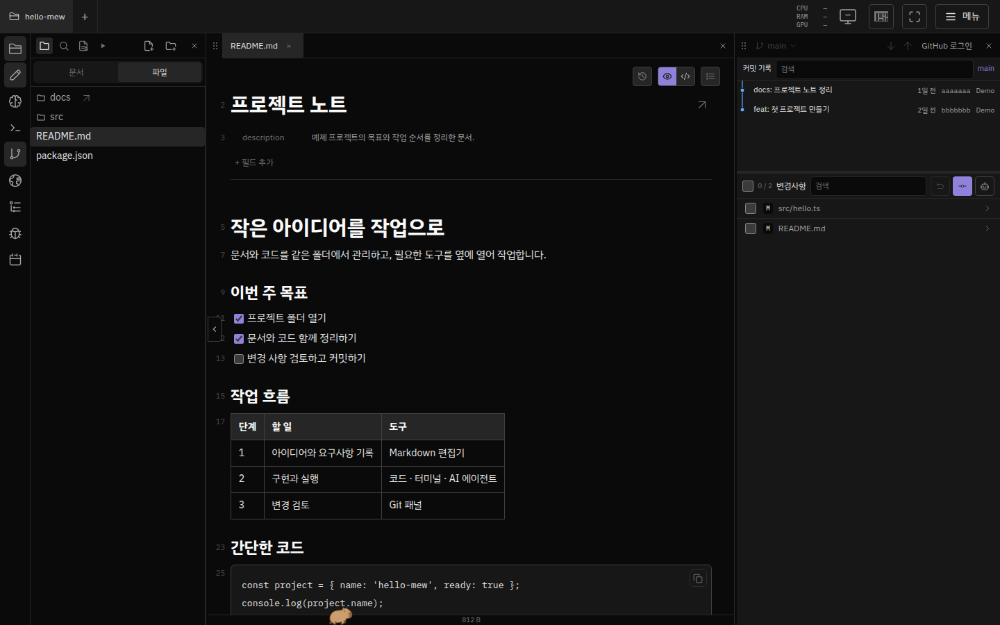
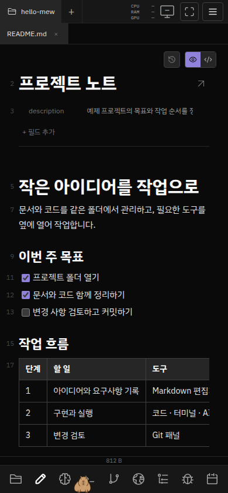

# mew 소개와 화면 둘러보기

**내 컴퓨터의 폴더를, 브라우저에서 쓰는 작업 공간으로.**

mew는 문서·코드·터미널·AI 에이전트·Git을 한 화면에서 엽니다. 파일은 컴퓨터나 서버의 폴더에 두고, 브라우저로 접속해 작업합니다. Linux·macOS에서 실행하며 Windows에서는 WSL 2를 사용합니다.

[설치하기](getting-started-ko.md) · [첫 프로젝트 열기](first-steps.md) · [사용법 찾기](MOC.md)

## 문서를 읽으면서 코드 작업하기

왼쪽에서 프로젝트 파일을 고르고, 문서와 코드를 나란히 엽니다. 탭을 편집 칸 가장자리로 끌면 화면을 나눌 수 있습니다. 작업에 따라 터미널·에이전트·Git 같은 패널도 독에서 열어 배치합니다.

문서에 요구사항을 쓰고 옆에서 구현을 확인할 때, 또는 코드와 설명을 함께 검토할 때 사용할 수 있습니다. [화면 분할과 탭 사용법](editor.md#편집-칸-문서-탭--화면-분할) · [터미널·에이전트 사용법](terminal-agents.md).

## Markdown을 바로 편집하기

**Hotview**는 제목·체크리스트·표·코드 블록을 렌더링하면서 편집합니다. 문서 위쪽에는 YAML 속성이 표시됩니다. 원문으로 전환해 Markdown 구문을 직접 수정할 수도 있습니다.

본문은 자동으로 파일에 저장됩니다. Git 커밋은 별도 작업입니다. 문서 링크와 Documents 목록으로 관련 파일을 찾아 이동할 수 있습니다. [편집·저장·PDF·미디어 안내](editor.md).

## Git 변경 검토하기

독의 **Git**에서 현재 프로젝트의 변경 파일과 커밋 기록을 확인합니다. 변경 파일을 열면 에디터에서 diff를 볼 수 있으며, 커밋할 파일을 골라 기록할 수 있습니다.

AI 에이전트가 작업한 뒤 어떤 파일이 바뀌었는지 확인하는 데도 사용할 수 있습니다. [Git 패널과 선택 커밋 사용법](projects.md#git-작업-패널).

## 휴대폰에서 이어 보기

휴대폰에서는 한 패널을 화면에 띄우고 아래 독으로 문서·파일·에이전트 등을 전환합니다. 같은 프로젝트 파일에 접근하므로, 컴퓨터에서 작업한 내용을 휴대폰에서 확인할 수 있습니다.

외부에서 접속하려면 로컬 mew의 **메뉴 → Mewlink → 원격 접속 → 기기 등록**을 마친 뒤 기기 주소를 엽니다. 호스트가 켜져 있고 mew가 실행 중이어야 합니다. [외부 접속](getting-started-ko.md#외부에서-접속하기) · [모바일 조작](editor.md#모바일과-전체화면).

## 에이전트와 화면 설정하기

독의 **에이전트**에서 런타임을 선택해 대화를 시작합니다. 런타임의 설치와 인증이 필요하며, **Skills 관리 → Mew**에서 기본 문서화·커밋 스킬을 확인할 수 있습니다. 새 문서의 기본 언어는 에이전트의 응답 언어 설정을 따릅니다. [런타임 준비](../configuration/agent-runtimes.md) · [기본 스킬](../configuration/agent-harness.md) · [응답 언어와 지침](project-setup.md).

새 브라우저의 기본 테마는 미드나이트입니다. 화면의 테마·글꼴·독은 설정에서 바꿉니다. 화면 아래의 **뮤펫**은 눌러 알림과 자원 정보를 확인하거나, 에이전트를 연결해 도우미 대화를 열 수 있습니다. 이 문서의 화면은 dark 테마와 내장 카피바라 뮤펫을 사용합니다. [화면 설정](../configuration/appearance.md) · [뮤펫 도우미](<../features/화면·계정·운영/뮤펫 도우미·대화·Mew 조작.md>).

## 그 밖에 할 수 있는 일

| 하고 싶은 일 | 안내 |
| --- | --- |
| 여러 폴더와 프로젝트를 전환하고 파일 찾기 | [프로젝트·파일·검색](projects.md) |
| AI 런타임을 연결하고 대화·터미널 사용하기 | [터미널·에이전트](terminal-agents.md) · [런타임 설정](../configuration/agent-runtimes.md) |
| 문서 공동 편집, 댓글, 채팅, 게스트 공유 | [협업과 공유](collaboration.md) |
| 로그인 화면·localhost 앱 또는 Android 사용하기 | [로그인·localhost 앱·Android](browser.md) |
| 컴퓨터 화면에 직접 접속하기 | [원격 데스크톱](remote-desktop.md) — 구성 요소 설치와 OS 권한 필요 |
| 문서에 데이터베이스 표 넣기 | [Postgres 표](database.md) — 별도 DB 연결 필요 |
| 반복 명령과 예약 작업 설정하기 | [명령 버튼·예약](commands.md) |

## 시작하기

1. [운영체제에 맞게 설치](getting-started-ko.md)하고 임시 비밀번호를 바꿉니다.
2. [첫 사용 안내](first-steps.md)에 따라 폴더와 문서를 엽니다.
3. 필요한 기능은 [사용법 홈](MOC.md), 구현·운영 자료는 [전체 문서 홈](../MOC.md)에서 찾습니다.

화면은 2026-10-15에 실행 중인 mew의 UI를 Playwright로 촬영했습니다. 촬영 당시 기본값인 dark 프리셋과 내장 카피바라 뮤펫을 사용하고, 공개용 예제 폴더·문서·Git 기록을 브라우저의 모의 API 응답으로 제공했습니다. 실제 계정·개인 파일·대화는 포함하지 않았습니다. 데스크톱 이미지는 1440 × 900, 모바일 이미지는 390 × 844 브라우저 viewport이며 실기기 촬영은 아닙니다. 이미지의 Git 기록은 기능 설명용 예제이며 실제 저장소 이력이 아닙니다. 화면 크기·버전에 따라 배치는 달라질 수 있습니다.
