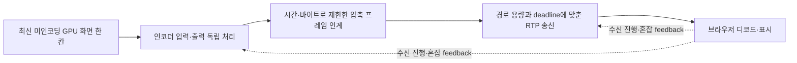

> 아래 조사와 합성 재현은 2026-10-20 [결정 0024](../decisions/0024-remote-desktop-fhd-pipeline.md)의 후속 개선을 구현하기 전 코드 기준이다. 이후 최대 두 프레임의 처리 중첩·RTT 재학습·시간 기반 품질 회복·Windows 설정 적용 확인과 단계별 진단을 반영했다. 현재 계약과 검증 범위는 [공통 아키텍처](../development/remote-desktop.md)를 따른다. 연구 원문과 수치는 보존하며, 실제 GPU·외부망·운영 적용과 StarDesk 직접 비교는 후속 결정에서도 별도 확인 대상으로 남아 있다.

Mew가 높은 화질에서도 빠르게 반응하려면 **인코더와 전송을 겹쳐 처리하고, 잘못된 감속을 없애며, 글자 선명도와 움직임을 함께 평가해야 한다.** 현재 구조에는 이 세 가지를 개선할 구체적인 여지가 있다. 비트레이트·FPS 상한을 더 높이는 작업만으로는 남은 병목을 해결하기 어렵다.

이 문서는 2026-10-20 작업 트리의 상주 네이티브 경로를 조사한 연구다. 현재 계약은 [공통 아키텍처](../development/remote-desktop.md), [Mac/Linux 경로](../development/remote-desktop-posix.md), [외부 직결](../development/remote-desktop-connectivity.md), [ADR 0009](../decisions/0009-remote-desktop-quality-latency.md)를 따른다. 아래 설계는 미구현 제안이다. 사용자 비교 환경의 OS·GPU·망·실제 협상 모드는 아직 확인하지 못했으며, StarDesk와 동일 기기에서 직접 비교하지 않았다.

## 공개 자료에서 확인한 비교 대상

| 구분 | 확인한 내용 | 비교할 때의 의미 |
| --- | --- | --- |
| StarDesk 공개 사양 | 최대 4K·144FPS·HDR을 안내한다 | 모든 기기·설정의 동시 달성이나 지연 실측을 뜻하지 않는다. [공식 소개](https://www.stardesk.net/lp/main/) |
| 글자 선명도 | 4:4:4 True Color를 제공한다. 일부 기기에서는 Original과 함께 사용할 수 없고 GPU 과부하 시 실패할 수 있다 | 작은 유색 글자의 품질은 영상 비트레이트와 별도로 비교해야 한다. [공식 도움말](https://www.stardesk.net/help/stardesk-true-color.html) |
| 기기별 차이 | 2026-08-25 도움말은 Android·일부 구형 macOS의 True Color 미지원을 명시한다 | 사용자가 비교한 기기에서 4:4:4를 사용했는지 확인해야 한다. [지원 조건](https://www.stardesk.net/help/true-color-missing.html) |
| 지연 기술 설명 | 자사 블로그는 복사 최소화, 하드웨어 우선, 작은 버퍼, 자체 혼잡 제어와 가속망을 설명한다 | 공개 구현이나 독립 벤치마크는 아니다. 구체 코덱·GPU 경로·제어 알고리즘을 추정 근거로 삼지 않는다. [자사 설명](https://www.stardesk.net/blog/stardesk-zero-latency-remote-desktop.html) |

StarDesk의 특정 코덱은 이번 공식 자료 조사에서 확인하지 못했다. 공식 소개의 연결 정책은 P2P 직결 우선·실패 시 relay이며, 사용자가 비교한 세션의 실제 경로는 미확인이다. 같은 LAN에서의 처리 성능과 외부망의 경로 차이를 분리해서 비교해야 한다.

## 현재 코드에서 남은 병목

[이전 고화질·144Hz 연구](원격%20데스크톱%20고화질과%20144Hz%20최적화.md)의 1080p·60FPS·6Mbps 고정 제한은 이후 구현으로 해소됐다. 현재는 4K·240FPS 요청, High/Baseline 협상, GPU NV12 변환, Windows 표면 3개 재사용, 유한 pacer와 인코더·pacer 비트레이트 연동을 이미 제공한다. Windows/Mac에 비압축 화면의 CPU 왕복을 새로 제거해야 한다고 설명하면 부정확하다.

| 우선순위 | 코드로 확인한 동작 | 성능에 미칠 수 있는 영향 |
| --- | --- | --- |
| P0 | [Windows worker](../../native/remote-desktop/gpu-worker.mjs)의 `waiting`과 [POSIX worker](../../native/remote-desktop/gpu-posix-worker.mjs)는 프레임을 보낸 뒤 ACK까지 `gpu.next()`를 호출하지 않는다. [호스트](../../native/remote-desktop/native-host.mjs) → [nativeDirect](../../native/remote-desktop/native-direct.mjs) → [pacer](../../native/remote-desktop/video-pacer.mjs)의 ACK는 프레임 전체를 송신하거나 폐기한 뒤 발생한다 | 큰 프레임의 송신 대기가 다음 인코더 입력·출력 처리까지 막는다. 품질을 높여 프레임이 커질수록 처리 중첩의 이점이 사라질 수 있다. ACK는 수신·표시 완료 확인이 아니다 |
| P0 | [적응 제어](../../native/remote-desktop/video-adaptation.mjs)의 `minimumRtt`는 세션 전체 최솟값이다. 현재 RTT가 이 값보다 25ms 높으면 반복 감속한다. 회복은 500ms 이상 간격으로 4%씩이다 | 경로의 지연 기준이 바뀌어도 이를 계속 혼잡으로 취급할 수 있다. 잠깐 감속한 뒤 화질이 오랫동안 낮게 남을 수 있다 |
| P0 | [Windows C++](../../native/remote-desktop/gpu-windows.cpp)의 초기 저지연·CBR·VBV·B-frame 설정 결과가 무시된다. 동적 비트레이트 함수의 반환값도 [JS wrapper](../../native/remote-desktop/gpu-windows.mjs)에서 버린다 | 실제 인코더가 변경을 거부하면 pacer만 감속하고 큰 압축 프레임은 계속 나올 수 있다. 현재 사용 GPU에서 실패했는지는 미확인이다 |
| P1 | Windows 영상 timestamp는 WGC 원본 시각 대신 입력 제출 직전 QPC에서 만든다. pacer `queueMs`는 JS에 프레임이 도착한 뒤부터 센다 | 캡처 pool·인코더 내부의 대기가 통계에 숨는다. 표시된 전송 대기가 작아도 화면은 오래됐을 수 있다 |
| P1 | [수신 feedback](../../src/utils/desktop-video.ts)은 디코드 비용·프레임 증분을 보내지만 적응 제어는 `decode` 비용을 판단에 쓰지 않는다. 동적 FPS 조절도 없다 | 네트워크 부족과 수신기 처리 부족에 같은 대응을 하거나 수신기 과부하를 놓칠 수 있다 |
| P1 | Windows 커서 검사는 영상과 같은 worker poll 안에서 약 33ms 간격이다 | 송신 대기가 커서 메타데이터 갱신도 막는다. 로컬 커서 반응과 실제 원격 앱 반응은 별개다 |
| P2 | [영상 협상](../../native/remote-desktop/video-settings.mjs)은 H.264 High/Baseline만 제공한다. [가상 화면](../../native/remote-desktop/virtual-display-driver.cpp)은 단일 1080p·60Hz 모드다 | 수신 레벨·원본 주사율을 넘는 설정 요청은 실제 고주사율을 만들지 못한다. Level 5.2 응답에서는 FHD 240 요청이 165FPS, QHD는 144FPS, 4K는 60FPS로 제한될 수 있다 |

OS 캡처 세션 자체가 ACK 대기 중 종료되는 것은 아니다. Windows WGC pool과 Mac ScreenCaptureKit callback은 살아 있지만 Windows의 dequeue·변환·encoder submit/drain, Mac의 출력 소비·다음 submit이 멈춘다. Linux는 appsink의 한 프레임 버퍼를 소비하지 못하면 상류에 backpressure가 걸린다. Linux X11에는 CPU 캡처 후 GPU 업로드도 남아 있다. OS별 실제 사용 환경에 따라 우선순위가 달라진다.

Windows의 설정 적용 확인에는 반환 코드를 정확히 구분해야 한다. `ICodecAPI::SetValue`의 `S_FALSE`는 읽기 전용을 뜻하지만 현재 C++의 `SUCCEEDED()`는 이를 성공으로 처리할 수 있다. `S_OK`, 지원 여부·읽기 값, 실제 출력 비트레이트를 함께 확인하는 편이 타당하다. [Microsoft API 계약](https://learn.microsoft.com/en-us/windows/win32/api/strmif/nf-strmif-icodecapi-setvalue)

## 현재 로직으로 재현한 취약성

실제 GPU나 네트워크 대신 현재 `videoAdaptation()`에 가짜 시계와 합성 feedback을 넣었다. 아래 값은 로직의 반응이며 사용자의 실제 지연·화질 측정이 아니다.

| 입력 조건 | 재현 결과 | 해석 범위 |
| --- | --- | --- |
| 최대 12Mbps. 최초 RTT 10ms 후 200ms마다 RTT 40ms, 손실 0, 수신 버퍼 평균 10ms, 수신·디코드 각 12프레임, 디코드 1ms | 4초 후 350kbps | 다른 입력이 정상이어도 RTT의 지속 상승만으로 비트레이트 바닥에 도달한다. 실제 망의 지연 상승이 혼잡인지 경로 변경인지는 이 실험으로 구분하지 못한다 |
| 최대 24Mbps. 200ms마다 혼잡 이벤트를 30회 발생시켜 350kbps로 감속. 이후 250ms마다 RTT 5ms·손실 0·버퍼 10ms·수신/디코드 각 36프레임·디코드 1ms | 마지막 혼잡 이벤트부터 24Mbps 복구까지 55초 | 첫 정상 feedback은 마지막 혼잡 250ms 뒤다. 표본 주기와 요청 상한에 따른 결과이며 정상화 뒤 화질 회복이 느릴 수 있음을 보여준다 |
| 최대 24Mbps. 250ms마다 RTT 5ms·손실 0·버퍼 10ms·수신 36프레임·디코드 2프레임·디코드 80ms | 10초 뒤에도 목표 24Mbps 유지 | 현재 적응 제어가 큰 디코드 비용만으로 전송 모드나 FPS를 낮추지 않는다는 것을 확인한다. 실제 decoder의 동작을 모사한 벤치마크는 아니다 |

고정 수신 버퍼를 혼잡으로 오판하던 문제와 짧은 타이머의 처리량 손실은 ADR 0009로 이미 보완했다. 위 문제는 그 변경 이후에도 남는다. 현재 feedback은 연결 후 약 200ms마다, UI 표시는 약 1초마다 갱신한다.

## 권장 구현 순서와 통과 조건

### 1. 단계별 지연을 측정하고 잘못된 감속부터 제거

첫 구현 단위는 원본 capture 시각 → dequeue → 변환/encode 제출 → encode 출력 → pacer 진입/완료를 연결하는 계측이다. 압축 프레임 크기·IDR 크기, 설정 요청/적용 결과, 실제 출력률, 재전송량을 함께 본다. 호스트와 브라우저 등 서로 다른 시계의 값을 직접 빼지 않고 시계 변환·동기화 오차를 기록한다. 영상·입력 내용이나 자격증명을 저장하지 않고 익명 집계값으로 충분하다.

RTT 기준에는 유효기간·경로 변경 재학습과 혼잡 지속 여부 판단을 설계한다. 단순히 기준을 올려 실제 bufferbloat를 정상화하지 않도록 손실·수신 진행·도착률·큐 증가를 함께 사용한다. 회복은 시간에 비례하는 정책과 제한된 탐색으로 바꾸어 feedback 주기에 따라 회복 속도가 달라지는 문제도 피한다. Windows 설정 실패는 상위로 전달하고 지원되지 않는 속성의 처리·재초기화를 명시한다.

통과 조건은 위 합성 RTT 사례에서 불필요한 반복 붕괴를 막고, 실제 지속 혼잡에서는 큐가 계속 쌓이지 않으며, 정상화 후 화질 회복 시간이 줄어드는 것이다. 인코더 제어 거부·읽기 전용 속성·낮은 디코드 처리량도 별도 회귀 사례로 다룬다.

### 2. 인코더 처리와 송신을 겹치되 오래된 프레임은 만들지 않기

송신 완료 ACK와 worker의 다음 poll을 분리한다. 인코더가 점유한 GPU 표면은 기존 tracked sample 수명을 지키고, 아직 인코딩하지 않은 화면은 최신 화면으로 교체한다. 송신 중에도 encoder 출력을 배출하되 압축 큐는 유한하게 유지한다. 네트워크보다 빠르게 계속 인코딩하는 방식은 피한다.

이미 인코딩한 P-frame을 임의로 최신 프레임으로 교체하면 참조 관계가 깨진다. 입력 전에 생략하거나 참조 구조를 이해하는 폐기·IDR 복구 정책이 필요하다. 큰 IDR과 재전송도 같은 전송 예산에 포함한다. 커서 메타데이터는 영상 송신 대기와 분리한다.

동일 코덱·화질·출력 크기에서 encoder 입력 간격, 실제 표시 FPS, 입력 후 표시 p95가 개선되고 큐·메모리·복구 정지가 악화되지 않아야 통과한다. 일반 100ms/IDR 500ms라는 기존 자체 송신 한도는 총지연 목표가 아니며, 개선 뒤 실제 프레임 age에 맞춰 다시 평가한다.

### 3. 패킷 도착 기반 혼잡 제어와 하드웨어 설정 비교

현재 수신 증분·RTT·버퍼 기반 제어를, TWCC/GCC 같은 성숙한 패킷 도착 기반 제어를 사용하는 전송 경로와 격리 비교한다. 라이브러리 기능 이름만 연결해 완료로 보지 않고 RTP 확장 협상, 수신 feedback, 재전송·입력 대역폭, 큐 측정을 끝까지 확인한다. JS 패킷별 할당·1ms 타이머의 비용은 CPU profile로 병목이 확인되면 네이티브 처리 후보로 삼는다.

Windows Media Foundation의 실제 설정·출력이 병목이면 NVENC·QSV·AMF 전용 경로와 비교할 가치가 있다. NVIDIA는 LL/ULL tuning과 P1–P7 preset을 별도 선택축으로 제공한다. 작은 VBV와 재정렬·미래 프레임 대기 제거를 기본으로 두고 preset·AQ·multi-pass는 품질과 지연을 함께 측정해 선택한다. 가장 느린 HQ 설정을 고화질의 기본값으로 삼지 않는다. [NVIDIA 공식 지침](https://docs.nvidia.com/video-technologies/video-codec-sdk/13.1/nvenc-video-encoder-api-prog-guide/index.html)

### 4. HEVC·AV1과 글자 선명화를 별도 실험

브라우저에서 H.264만 가능하다는 전제는 현재 맞지 않는다. Chrome 136은 WebRTC HEVC 지원과 MediaCapabilities 조회를 공식 발표했다. Mew에는 인코더·SDP·RTP packetizer·수신 검사까지 해당 코덱 경로를 추가해야 하며, 브라우저 지원 발표만으로 사용할 수 있는 것은 아니다. [Chrome 릴리스](https://developer.chrome.com/release-notes/136#h265_hevc_codec_support_in_webrtc)

H.264/HEVC/AV1을 실제 송수신 GPU와 해상도·FPS별로 협상한다. 지원 조회 뒤 지속 디코드와 표시를 검증하고, 하드웨어 가속·지연·소비 전력·동일 화질의 필요 전송량을 비교한다. HEVC나 AV1이 모든 기기에서 더 빠르다고 가정하지 않는다. HEVC 전환만으로 4:4:4가 되는 것도 아니다.

현재 NV12 4:2:0의 색 해상도 손실은 비트레이트만 올려 완전히 복원하기 어렵다. 글자·얇은 유색 선은 native 4:4:4를 실제로 지원하는 조합, 글자 영역의 품질 배분, 정지 영역의 점진적 선명화를 비교한다. 움직임을 먼저 짧은 지연으로 보여주고 안정된 영역에 정밀 정보를 보태는 방향은 Mew의 문서·코드 작업에 잘 맞는 후보이다. 이는 성능 결과가 아닌 설계 판단이다.

Microsoft AVC444는 두 4:2:0 view로 색 정보를 복원하고 보조 색 정보를 나중에 개선하는 구조를 규정한다. 이 원리를 참고할 수 있지만 Mew의 자체 보조 영상·타일 구현과 같은 기능은 아니다. 추가 디코드·GPU 합성·대역폭·프레임/화면 세대 동기화 비용을 먼저 검증해야 한다. [Microsoft 프로토콜](https://learn.microsoft.com/en-us/openspecs/windows_protocols/ms-rdpegfx/844018a5-d717-4bc9-bddb-8b4d6be5dd3f)

### 5. 원본 주사율과 브라우저 표시 한계를 넘을 필요가 있는지 판단

물리/가상 화면의 실제 모드, 수신 디스플레이 Hz, 협상한 코덱 모드, 디코드·표시 FPS를 따로 확인한다. 가상 화면이 60Hz라면 필요한 해상도·주사율 모드를 드라이버에 추가하고 서명·설치·헤드리스 실기를 검증해야 한다.

브라우저의 `jitterBufferTarget=0`은 이미 설정하지만 실제 0ms 버퍼를 보장하지 않는다. `requestVideoFrameCallback`의 표시 진행·가능한 timing과 WebRTC stats를 함께 관찰한다. 이것도 물리 디스플레이의 광자 출력 측정과는 구분한다. [WebRTC 수신 버퍼 계약](https://www.w3.org/TR/webrtc/#dom-rtcrtpreceiver-jitterbuffertarget)

기기별 브라우저 경로를 개선해도 목표하는 4:4:4 하드웨어 디코드·표시 지연을 충족하지 못할 때 선택적 네이티브 뷰어를 검토한다. WebCodecs를 사용해도 `prefer-hardware`는 보장이 없는 힌트이며, 전송·복구·표시 제어를 새로 책임져야 한다. 브라우저 전체가 느리다고 결론 내리기 전에 단계를 계측한다. [WebCodecs 계약](https://www.w3.org/TR/webcodecs/#videodecoderconfig)

현재는 직접 연결만 허용한다. 외부망에서 StarDesk와 경로가 달라 생기는 격차는 캡처·코덱 최적화로 모두 해소되지 않는다. 중계·가속망 도입은 운영비와 기존 직접 연결 정책을 바꾸므로 별도 결정 대상이다.

## 우위를 판단할 비교 실험

같은 호스트·클라이언트·소스 화면·표시 주사율·네트워크에서 Mew와 StarDesk를 번갈아 실행한다. OS·GPU·드라이버·브라우저/앱 버전, 실제 코덱·해상도·FPS·색 모드·연결 경로를 기록한다. 설치된 Mew helper와 작업 트리의 버전 일치도 먼저 확인한다.

| 비교 축 | 측정 항목 |
| --- | --- |
| 동일 화질에서 더 빠른가 | 글자·색 정확도와 움직임 품질을 맞춘 뒤 입력 후 표시 p50/p95/p99, 긴 멈춤, 표시 FPS 비교 |
| 동일 지연에서 더 선명한가 | 같은 지연 예산에서 작은 글자·1px 유색 선·스크롤·게임 장면의 원본 대비 품질 비교. 사진용 점수 하나로 글자 품질을 대체하지 않는다 |
| 연결이 흔들려도 유지되는가 | 별도 격리 망에서 용량 변화·손실·RTT 기준 상승을 주고 감속·화질 회복 시간·IDR 복구 측정 |
| 어느 단계가 비용을 쓰는가 | 호스트 capture/encode·실제 송출률/재전송, 수신 버퍼·decode·drop/freeze·표시 진행, 양쪽 CPU/GPU·전력 비교 |

문서·IDE의 정지 화면/빠른 스크롤, 영상·게임, 원격 GPU 고부하를 나누고 LAN과 외부망도 분리한다. 우선 FHD/QHD 60·120/144Hz에서 비교하고, 지원이 확인된 조합에서 4K로 확장한다. 각 조건은 예열 뒤 10분 이상·3회 교대 측정을 제안한다. 지원되지 않는 기기에 명목상 같은 FPS만 요청해서 비교하지 않는다.

입력 후 표시 지연은 외부 고속 촬영 등으로 입력 사건과 화면 변화를 함께 잡는다. 240FPS 촬영의 한 프레임은 약 4.17ms이므로 작은 차이는 측정 해상도·오차와 함께 보고한다. RTT나 로컬 커서의 즉시 이동을 이 지연으로 대신하지 않는다. WebRTC 누적 통계는 구간 증분으로 계산하고 미지원 값은 0으로 취급하지 않는다. [W3C 통계 정의](https://www.w3.org/TR/webrtc-stats/)

개발 목표의 초안은 **동일 이상 화질에서 입력 후 표시 p95를 StarDesk보다 30% 이상 줄이고, 합의한 지연 예산에서는 글자·색 정확도를 개선하며, 긴 멈춤·표시 FPS가 악화되지 않는 것**이다. 수치는 달성 보장이 아닌 비교 기준 제안이다. 실측으로 우선 가능한 기기·작업 범위를 정한 뒤 제품 목표로 확정한다.

## 이번 조사에서 수행한 검증

- 현재 네이티브 캡처·인코더·송신·수신 코드, ADR 0009와 현재 소유 문서를 대조했다. 이전 Electron/VP8 경로의 제한을 현재 경로로 사용하지 않았다.
- 현재 `videoAdaptation()`을 직접 import해 위 세 가지 합성 시나리오를 실행했다. 실기 인코더·실제 네트워크 성능 검증은 아니다.
- `node --test server/remote-desktop-video.test.ts src/utils/desktop-video.test.ts`: 21개 통과. 설정·협상·pacing·feedback 회귀 확인이며 StarDesk 대비 우위를 검증하지 않는다.
- `npm run check:docs`: description·내부 링크 검사 통과.
- 공식 제품 도움말·브라우저 릴리스·표준·GPU 제조사 문서를 확인했다. 실제 GPU 캡처, StarDesk 실행, 앱 빌드·배포·재시작은 수행하지 않았다.

첫 후속 구현은 단계별 계측·Windows 설정 적용 확인·혼잡 제어의 기준과 회복 정책을 한 작업으로 묶는 것이 타당하다. 이어서 송신과 인코더 처리를 분리한 H.264 경로를 비교하면, 코덱 전환 전에 해소 가능한 격차와 코덱·표시 경로를 바꿔야 하는 격차를 구분할 수 있다.
